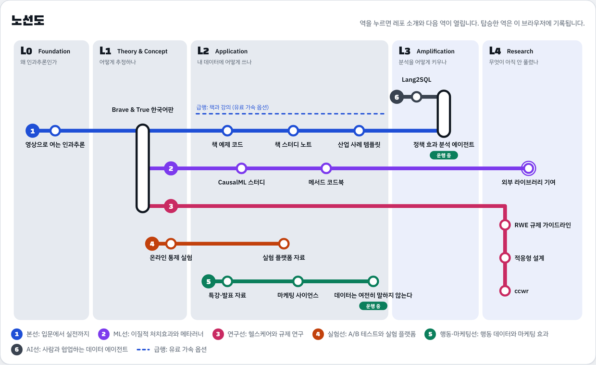

# 인과추론 노선도

가짜연구소 인과추론팀의 오픈소스 허브입니다. 팀이 2022년부터 만든 레포를 학습 단계(L0–L4)와 트랙(노선)으로 엮고, 프로젝트를 연 Builder와 팀이 걸어온 길을 한곳에 모았습니다.

**사이트: https://causalinferencelab.github.io**



> **English summary.** This repository is the hub of the Pseudo-Lab Causal Inference Team. It shows how the team has grown (runners, projects, stars, event attendance), the current cohort, the Builders who led each project and the team's history by cohort, and it maps our repositories onto five learning levels and six tracks drawn as metro lines. The site is plain HTML, CSS and JavaScript that reads JSON files in `data/`, so adding a repository or a project is a one-file pull request.

## 허브에서 볼 수 있는 것

| 섹션 | 내용 |
| --- | --- |
| 성장 지표 | 함께한 러너(중복 제외), 프로젝트, GitHub 스타, 행사 참가자가 기수와 함께 어떻게 늘었는지 보여 줍니다. |
| 이번 기수 | 지금 진행 중인 프로젝트와 직전 기수가 마친 프로젝트, 각 프로젝트의 Builder와 러너 수입니다. |
| Builder | 프로젝트를 이끈 Builder별 프로젝트 수, 함께한 러너 수, 첫 기수와 프로젝트 목록입니다. |
| 시즌 기록 | 4기(2022 상반기)부터 기수별 프로젝트와 러너 수입니다. |
| 행사 | Data Forum 회차별 참가자 수와 다음 행사입니다. |
| 어디서 시작할까요 | 하고 싶은 일을 고르면 노선도 위에 경로를 안내합니다. 구역별(L0–L4) 보기도 있습니다. |
| 레포 둘러보기 | 노선별로 거를 수 있는 레포 목록입니다(스타 순). |

러너는 이름 없이 숫자로만 보여 줍니다. 이름은 Builder만 표시합니다.

## 커리큘럼: 다섯 개의 구역

L0–L2는 **배우는 구역**이고 무료 자료만으로 끝까지 갈 수 있습니다. L3–L4는 **만드는 구역**입니다. 책과 강의는 노선도에 점선 "급행"으로 표시한 가속 옵션입니다.

| 구역 | 질문 | 대표 레포 |
| --- | --- | --- |
| L0 Foundation | 왜 인과추론인가 | [causal-studio](https://github.com/CausalInferenceLab/causal-studio) |
| L1 Theory & Concept | 어떻게 추정하나 | [Causal-Inference-with-Python](https://github.com/CausalInferenceLab/Causal-Inference-with-Python), [OCE-Materials](https://github.com/CausalInferenceLab/OCE-Materials) |
| L2 Application | 내 데이터에 어떻게 쓰나 | [causal-inference-in-python-code](https://github.com/CausalInferenceLab/causal-inference-in-python-code), [causal-inference-practice](https://github.com/CausalInferenceLab/causal-inference-practice), [causal-inference-lecture](https://github.com/CausalInferenceLab/causal-inference-lecture) 외 |
| L3 Amplification | 분석을 어떻게 키우나 | [Lang2SQL](https://github.com/CausalInferenceLab/Lang2SQL), [policy-effect-analytics-agent](https://github.com/CausalInferenceLab/policy-effect-analytics-agent) |
| L4 Research | 무엇이 아직 안 풀렸나 | [ccwr](https://github.com/CausalInferenceLab/ccwr), RWE 가이드라인·적응형 설계 스터디 |

## 여섯 개의 노선

| 노선 | 다루는 것 |
| --- | --- |
| 1호선 본선 | 입문 영상에서 번역서, 책 코드, 산업 사례 템플릿, 정책 효과 분석까지 |
| 2호선 ML선 | 이질적 처치효과와 메타러너, 외부 라이브러리 기여 |
| 3호선 연구선 | Real-World Evidence, 적응형 임상 설계, target trial emulation |
| 4호선 실험선 | 온라인 통제 실험과 실험 플랫폼 |
| 5호선 행동·마케팅선 | 현업 특강, 마케팅 사이언스, 행동 데이터 리딩 살롱 |
| 6호선 AI선 | 사람과 협업하는 데이터 에이전트 |

## 역의 상태

| 상태 | 기준 |
| --- | --- |
| 운행 중 | 이번 기수에 진행 중인 프로젝트 |
| 최근 업데이트 | 올해 코드나 내용이 갱신된 레포 |
| 완결 | 내용이 마무리되어 오류 수정 위주로 관리하는 레포 |
| 차량기지 | 허브 운영(이 레포, 프로젝트 템플릿)과 보관용 레포 |

## 참여하는 방법

1. **러너로 탑승**: 가짜연구소 기수 모집 때 인과추론팀 프로젝트에 러너로 참여합니다.
2. **첫 기여**: 운행 중인 레포의 이슈를 보고 PR을 보냅니다. 오탈자 하나, 예제 하나도 기여입니다.
3. **Builder로 노선 열기**: 다음 기수에 프로젝트를 열고, [Project-template](https://github.com/CausalInferenceLab/Project-template)으로 레포를 만든 뒤 이 허브에 역을 추가합니다.

질문은 [가짜연구소 디스코드](https://discord.gg/HeHbFAvmSZ)에 남겨 주세요.

## 허브에 내용 더하기

사이트는 빌드 도구 없이 `data/` 폴더의 JSON 파일을 읽어 그립니다. 대부분의 수정은 파일 하나를 고치는 PR이면 됩니다.

| 파일 | 고치는 경우 |
| --- | --- |
| `data/projects.json` | 기수별 프로젝트를 추가할 때. 러너는 인원수(`runners`)만 적습니다. |
| `data/builders.json` | Builder의 LinkedIn, GitHub 아이디(프로필 사진에 쓰임), 한 줄 소개를 넣을 때 |
| `data/growth.json` | 기수별 누적 러너 수. 프로젝트 시트를 xlsx로 내려받아 `python scripts/runners_from_sheet.py 파일.xlsx > data/growth.json`으로 만듭니다. 이름은 파일에 남지 않습니다. |
| `data/events.json` | Data Forum 같은 행사를 추가할 때 |
| `data/repos.json` | 레포(역)를 추가하거나 설명·레벨·노선·상태를 바꿀 때 |
| `data/map.json` | 노선도에서 역의 위치를 정할 때 |
| `data/routes.json` | 경로 안내 항목을 바꿀 때 |
| `data/articles.json`, `articles/*.md` | 읽을거리를 추가할 때 |
| `data/stats.json` | 직접 고치지 않습니다. 매주 GitHub Actions가 스타 추이와 기여자 수를 갱신합니다. |

레포를 추가할 때의 예시입니다.

```json
{
  "repo": "new-repo-name",
  "title": "노선도에 보일 이름",
  "summary": "한두 문장 소개",
  "level": "L2",
  "lines": ["main"],
  "status": "running",
  "builders": ["Builder 이름"],
  "cohorts": [13],
  "site": "https://causalinferencelab.github.io/new-repo-name/",
  "stars": 0
}
```

`stars`는 기본값이고, 사이트는 열릴 때 GitHub에서 최신 스타 수와 마지막 커밋 날짜를 불러옵니다.

## 로컬에서 보기

```bash
python3 -m http.server 8000
# http://localhost:8000
```

JSON을 `fetch`로 읽기 때문에 파일을 더블클릭해서 열면 데이터가 보이지 않습니다.

## 배포

`main`에 머지되면 GitHub Actions가 JSON 문법을 검사한 뒤 사이트 파일을 `gh-pages` 브랜치로 배포합니다 (`.github/workflows/deploy.yml`). 같은 워크플로가 매주 월요일 `scripts/update_stats.py`로 스타의 월별 추이, 기여자 수, 레포별 마지막 커밋 날짜를 모아 `data/stats.json`에 반영한 뒤 다시 배포합니다. 머지 직후 Actions 탭에서 "Run workflow"를 한 번 누르면 바로 채워집니다.

## 라이선스

[MIT](LICENSE)
