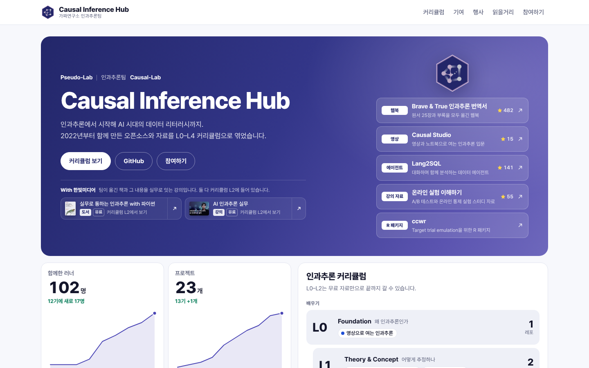

# Causal Inference Hub

**가짜연구소 인과추론팀이 2022년부터 함께 만든 오픈소스와 자료를 L0–L4 커리큘럼으로 엮은 곳입니다.**

인과추론에서 시작해 실험, 데이터 에이전트까지, AI 시대에 데이터로 판단하는 힘을 함께 공부하고 만듭니다.

**사이트: https://causalinferencelab.github.io**

## 인과추론팀은

[가짜연구소](https://pseudo-lab.com/)는 반기마다 기수를 모집해 함께 공부하고 만드는 AI·데이터 커뮤니티입니다. 인과추론팀은 4기(2022년 상반기)부터 매 기수 프로젝트를 열어 왔습니다. 프로젝트를 여는 사람을 **Builder**, 함께 참여하는 사람을 **러너**라고 부릅니다.

| 숫자로 보면 | |
| --- | --- |
| 함께한 러너 | 100명 이상 (중복 제외) |
| 기수별 프로젝트 | 23개, Builder 11명 |
| GitHub 스타 | 1,000개 이상 |
| Data Forum | 다섯 번째 행사 준비 중, 지금까지 330명 참가 |

## 이런 분께 맞습니다

- **인과추론을 처음 공부한다면:** 영상과 노트북으로 시작해 번역서로 개념을 익히는 길이 있습니다. 여기까지는 모두 무료입니다.
- **현업에서 A/B 테스트나 효과 분석을 한다면:** 온라인 실험 자료, 산업 사례 템플릿, 현업 특강 자료를 바로 쓸 수 있습니다.
- **직접 만들고 싶다면:** 데이터 에이전트, 연구용 R 패키지 같은 진행 중인 프로젝트에 기여하고, 다음 기수에 Builder로 프로젝트를 열 수 있습니다.

## 대표 오픈소스

| 구분 | 이름 | 한 줄 소개 |
| --- | --- | --- |
| 웹북 | [Brave & True 인과추론 번역서](https://causalinferencelab.github.io/Causal-Inference-with-Python/) | 『Causal Inference for The Brave and True』 원서 25장과 부록을 모두 옮긴 웹북 |
| 영상 | [Causal Studio](https://causalinferencelab.github.io/causal-studio/) | 영상과 노트북으로 여는 인과추론 입문 |
| 에이전트 | [Lang2SQL](https://github.com/CausalInferenceLab/Lang2SQL) | 사람과 대화하며 함께 분석하는 데이터 에이전트 |
| 강의 자료 | [온라인 실험 이해하기](https://github.com/CausalInferenceLab/OCE-Materials) | A/B 테스트와 온라인 통제 실험 스터디 자료 |
| R 패키지 | [ccwr](https://github.com/CausalInferenceLab/ccwr) | Clone-censor-weight 방식의 target trial emulation 패키지 |

팀 레포 전체는 허브의 트랙 지도와 커리큘럼 탭에서 볼 수 있습니다.

## 커리큘럼: L0–L4

L0–L2는 **배우는 단계**로, 무료 자료만으로 끝까지 갈 수 있습니다. L3–L4는 **만드는 단계**입니다.

| 단계 | 질문 | 대표 자료 |
| --- | --- | --- |
| L0 Foundation | 왜 인과추론인가 | [Causal Studio](https://github.com/CausalInferenceLab/causal-studio) |
| L1 Theory & Concept | 어떻게 추정하나 | [Brave & True 인과추론 번역서](https://github.com/CausalInferenceLab/Causal-Inference-with-Python), [온라인 실험 이해하기](https://github.com/CausalInferenceLab/OCE-Materials) |
| L2 Application | 내 데이터에 어떻게 쓰나 | [책 예제 코드](https://github.com/CausalInferenceLab/causal-inference-in-python-code), [산업 사례 템플릿](https://github.com/CausalInferenceLab/causal-inference-practice), [특강·발표 자료](https://github.com/CausalInferenceLab/causal-inference-lecture) 외 |
| L3 Amplification | 분석을 어떻게 키우나 | [Lang2SQL](https://github.com/CausalInferenceLab/Lang2SQL), [정책 효과 분석 에이전트](https://github.com/CausalInferenceLab/policy-effect-analytics-agent) |
| L4 Research | 무엇이 아직 안 풀렸나 | [ccwr](https://github.com/CausalInferenceLab/ccwr), RWE 가이드라인·적응형 설계 스터디, 외부 오픈소스 기여 |

자료는 주제에 따라 여섯 트랙(입문·기본, ML, 연구, 실험, 행동·마케팅, AI 에이전트)으로도 나뉩니다. 허브에서 "처음 시작해요", "A/B 테스트를 해요" 같은 목표를 고르면 볼 순서를 안내합니다.

## 한빛미디어와 함께

팀이 번역한 『[실무로 통하는 인과추론 with 파이썬](https://www.hanbit.co.kr/store/books/look.php?p_code=B6208936856)』(한빛미디어, 2024)과 그 내용을 실무로 잇는 온라인 강의 「[데이터 실무자의 사고력 강화: AI 인과추론 실무](https://www.hanbit.co.kr/product/C0781073345)」가 커리큘럼 L2에 들어 있습니다. 책의 장별 예제 코드와 발표 자료는 무료 레포로 공개되어 있습니다.

## 행사: Data Forum

현업과 학계가 만나는 Data Forum을 2024년부터 열고 있습니다. 회차별 내용과 다음 행사 일정은 허브의 행사 섹션에 있습니다.

## 참여하는 방법

1. **러너로 참여:** 가짜연구소 기수 모집 때 인과추론팀 프로젝트에 러너로 들어와 14주 동안 함께 공부하고 만듭니다.
2. **첫 기여:** 진행 중인 레포의 [열린 이슈](https://github.com/search?q=org%3ACausalInferenceLab+is%3Aissue+is%3Aopen&type=issues)를 보고 PR을 보냅니다. 오탈자 하나, 예제 하나도 기여입니다.
3. **Builder로 프로젝트 열기:** 다음 기수에 직접 프로젝트를 엽니다. 레포는 [Project-template](https://github.com/CausalInferenceLab/Project-template)으로 시작합니다.

질문은 [가짜연구소 디스코드](https://discord.gg/HeHbFAvmSZ)에 남겨 주세요.

## English summary

The Causal Inference Hub gathers the open-source work of the Pseudo-Lab Causal Inference Team since 2022 into one L0–L4 curriculum: from a video primer and the Korean edition of *Causal Inference for The Brave and True*, through applied templates and online-experiment materials, to a data agent (Lang2SQL) and a research R package (ccwr). Each cohort, Builders open projects and runners join them; the hub shows those projects, the people who led them, and how to take part.

## 허브를 고치려면

허브는 `data/` 폴더의 JSON 파일을 읽어 그리는 정적 사이트입니다. 레포나 프로젝트를 더하는 방법, 로컬에서 보는 법, 배포 방식은 [CONTRIBUTING.md](CONTRIBUTING.md)에 있습니다.

## 라이선스

[MIT](LICENSE)
