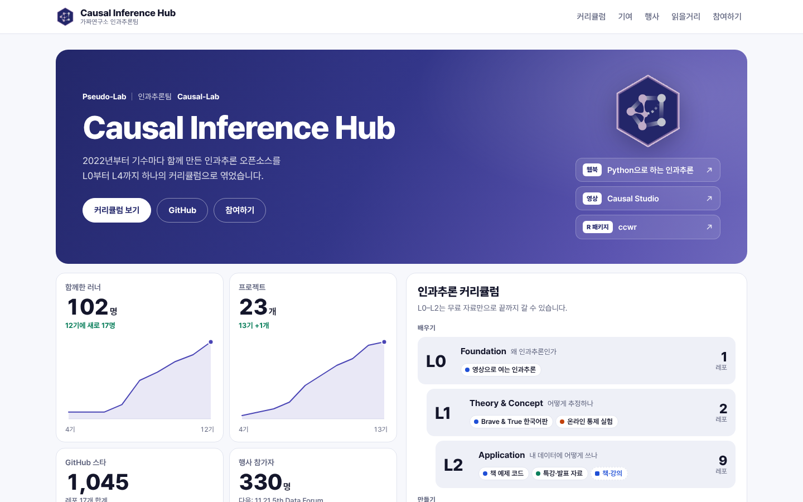

# Causal Inference Hub

**가짜연구소 인과추론팀이 2022년부터 함께 만든 오픈소스와 자료를 Level 0–4 커리큘럼으로 엮은 곳입니다.**

인과추론에서 시작해 온라인 실험, 데이터 에이전트까지 AI 시대에 데이터로 판단하는 힘을 함께 공부하고 만듭니다.

**[causalinferencelab.github.io](https://causalinferencelab.github.io)**

## 어디서 시작할까

| 이럴 때 | 여기서 |
| --- | --- |
| 내 수준부터 알고 싶다 | [3분 레벨 진단](https://causalinferencelab.github.io/?level): 실무 상황 문제 10개로 시작할 Level과 첫 자료를 알려 줍니다 |
| 처음 공부한다 | [Causal Studio](https://www.youtube.com/@CausalStudio): 짧은 입문 영상과 Colab 노트북으로 상관과 인과의 차이부터 |
| 글로 차근차근 읽고 싶다 | [Brave & True 웹북](https://causalinferencelab.github.io/Causal-Inference-with-Python/): 원서 25장과 부록 5편을 모두 옮긴 한국어판 |
| 현업 문제에 바로 쓰고 싶다 | [실무자 특강 영상 17강](https://www.youtube.com/playlist?list=PLKKkeayRo4PWuwIL0_C7n_QQQ_at6CpoE), [산업 사례 템플릿](https://github.com/CausalInferenceLab/causal-inference-practice), [온라인 실험 자료](https://github.com/CausalInferenceLab/OCE-Materials) |
| 직접 만들고 싶다 | [참여하는 방법](#참여하는-방법) |

여기까지의 자료는 모두 무료입니다. Causal Studio는 처음 보는 분을 위한 입문 영상이고, 실무자 특강 영상은 책의 장마다 현업 사례를 다루는 Level 2 자료라 개념을 익힌 뒤 보는 편이 좋습니다.

## 5th Data Forum: 2026.11.21(토)

**AI 시대 만드는 속도에서, 증명하는 힘으로**

- 13:30–17:30, 한빛미디어 리더스홀 (서울 서대문구 연희로2길 62 한빛빌딩 B동 1층)
- 신청 10.31(토)–11.15(일), 참가비 무료
- Keynote, 세미나 세 편, 패널토크, 네트워킹. 인과추론팀 Builder 추천 코드로 신청할 수 있습니다.
- [행사 페이지에서 신청](https://pseudo-lab.com/events/a1f10b8a-e898-47f1-86bb-0ba90bc8cc0e) · [포스터와 타임테이블은 허브 행사 섹션](https://causalinferencelab.github.io/#events)

## 커리큘럼: Level 0–4

레벨마다 이런 분께, 배우는 것, 끝나면 할 수 있는 것, 볼 순서가 정해져 있습니다. Level 0–2는 순서대로 볼 무료 자료로 배우고, Level 3–4는 이슈 댓글, 첫 PR, Builder 되기처럼 직접 만듭니다.

| 단계 | 질문 | 대표 자료 |
| --- | --- | --- |
| L0 입문 | 왜 인과추론인가 | [Causal Studio](https://github.com/CausalInferenceLab/causal-studio), [웹북 1장](https://causalinferencelab.github.io/Causal-Inference-with-Python/01-Introduction-To-Causality.html) |
| L1 개념 완성 | 어떻게 추정하나 | [Brave & True 웹북](https://github.com/CausalInferenceLab/Causal-Inference-with-Python), [온라인 실험 이해하기](https://github.com/CausalInferenceLab/OCE-Materials) |
| L2 실전 적용 | 내 데이터에 어떻게 쓰나 | [책 예제 코드](https://github.com/CausalInferenceLab/causal-inference-in-python-code), [실무자 특강 영상](https://www.youtube.com/playlist?list=PLKKkeayRo4PWuwIL0_C7n_QQQ_at6CpoE)([발표 자료](https://github.com/CausalInferenceLab/causal-inference-lecture)), [산업 사례 템플릿](https://github.com/CausalInferenceLab/causal-inference-practice) |
| L3 도구 개발 | 분석을 어떻게 키우나 | [Lang2SQL](https://github.com/CausalInferenceLab/Lang2SQL), [정책 효과 분석 에이전트](https://github.com/CausalInferenceLab/policy-effect-analytics-agent) |
| L4 연구 | 무엇이 아직 안 풀렸나 | [ccwr](https://github.com/CausalInferenceLab/ccwr), RWE 가이드라인·적응형 설계 스터디, 외부 오픈소스 기여 |

주제로 고르고 싶다면 허브의 노선도에서 여섯 트랙(입문·기본, ML, 연구, 실험, 행동·마케팅, AI 에이전트) 중 하나를 따라가면 됩니다.

## 허브에서 할 수 있는 것

| 기능 | 하는 일 |
| --- | --- |
| [자료실](https://causalinferencelab.github.io/library.html) | 인과추론 13개, 온라인 실험 10개 주제로 웹북 장, 영상, 책 코드, 발표 자료, 실험 플랫폼 사례를 찾습니다. 웹북 용어집 183개도 함께 있어 이중차분, CUPED, 실험군처럼 방법이나 용어 이름으로 찾을 수 있습니다 |
| Pseudo | 허브, 자료실, 연재 글 오른쪽 아래의 마스코트입니다. 용어를 물으면 뜻을 풀어 주고, 주제나 하고 싶은 일을 말하면 자료실에서 맞는 자료를 세 개까지 골라 줍니다. "영상으로", "더 보여 주세요" 같은 이어지는 질문, 두 용어의 차이, 다음 행사와 레벨 진단 안내도 합니다. 찾은 자료를 담은 프롬프트로 Claude에게 이어서 물어볼 수 있습니다 |
| [레벨 진단](https://causalinferencelab.github.io/?level) | 문제 10개로 시작할 Level, 첫 자료, 다시 볼 웹북 장을 알려 줍니다. 결과를 동료에게 보낼 수 있습니다 |
| [상관일까, 인과일까?](https://causalinferencelab.github.io/game.html) | 데이터 상황 10개를 보고 고르는 2분 게임 |
| [교란 실험실](https://causalinferencelab.github.io/lab.html) | 가상 사용자 800명으로 교란이 단순 비교를 얼마나 속이는지 직접 움직여 봅니다 |
| 활동 여권 | 자료 읽기, 레벨 클리어, 첫 기여 같은 행동마다 스탬프가 쌓입니다. 기록은 내 브라우저에만 남습니다 |
| [Builder 페이지](https://causalinferencelab.github.io/builders/) | 프로젝트를 연 Builder마다 이력, 만든 레포, 메달을 모았습니다 |
| 연재 | 팀원이 쓰는 글을 모읍니다. 매주 월요일 ‘이번 주 포스트’가 바뀝니다 |

## 대표 오픈소스

| 구분 | 이름 | 한 줄 소개 |
| --- | --- | --- |
| 웹북 | [Brave & True 인과추론 번역서](https://causalinferencelab.github.io/Causal-Inference-with-Python/) | 『Causal Inference for The Brave and True』 원서 25장과 부록을 모두 옮긴 웹북 |
| 영상 | [Causal Studio](https://causalinferencelab.github.io/causal-studio/) | 영상과 노트북으로 여는 인과추론 입문 |
| 에이전트 | [Lang2SQL](https://github.com/CausalInferenceLab/Lang2SQL) | 사람과 대화하며 함께 분석하는 데이터 에이전트 |
| 강의 자료 | [온라인 실험 이해하기](https://github.com/CausalInferenceLab/OCE-Materials) | A/B 테스트와 온라인 통제 실험 스터디 자료 |
| R 패키지 | [ccwr](https://github.com/CausalInferenceLab/ccwr) | Clone-censor-weight 방식의 target trial emulation 패키지 |

## 인과추론팀은

[가짜연구소](https://pseudo-lab.com/)는 반기마다 기수를 모집해 함께 공부하고 만드는 AI·데이터 커뮤니티입니다. 인과추론팀은 4기(2022년 상반기)부터 매 기수 프로젝트를 열어 왔습니다. 프로젝트를 여는 사람을 **Builder**, 함께 참여하는 사람을 **러너**라고 부릅니다.

러너 100명 이상, 기수별 프로젝트 23개와 Builder 11명, GitHub 스타 1,000개 이상, Data Forum 누적 참가 330명이 함께했습니다.

팀이 번역한 『[실무로 통하는 인과추론 with 파이썬](https://www.hanbit.co.kr/store/books/look.php?p_code=B6208936856)』(한빛미디어, 2024)과 온라인 강의 「[데이터 실무자의 사고력 강화: AI 인과추론 실무](https://www.hanbit.co.kr/product/C0781073345)」가 커리큘럼 L2에 들어 있습니다. 책의 예제 코드와 발표 자료는 무료 레포로 공개되어 있습니다.

현업과 학계가 만나는 Data Forum을 2024년부터 열고, 한국경영정보학회가 주최하는 [한국 비즈니스 실험 심포지엄](https://sites.google.com/view/business-experimentation2026/home)에도 협력하고 있습니다.

## 참여하는 방법

1. **러너로 참여:** 가짜연구소 기수 모집 때 인과추론팀 프로젝트에 러너로 들어와 함께 공부하고 만듭니다.
2. **첫 기여:** 진행 중인 레포의 [열린 이슈](https://github.com/search?q=org%3ACausalInferenceLab+is%3Aissue+is%3Aopen&type=issues)를 보고 PR을 보냅니다. 오탈자 하나, 예제 하나도 기여입니다.
3. **Builder로 프로젝트 열기:** 다음 기수에 직접 프로젝트를 엽니다. 레포는 [Project-template](https://github.com/CausalInferenceLab/Project-template)으로 시작합니다.
4. **Builder라면:** [프로필·회고 양식](https://github.com/CausalInferenceLab/CausalInferenceLab.github.io/issues/new?template=builder-profile.yml)으로 한 줄 소개와 회고 세 줄을 남겨 주세요. Builder 페이지에 실립니다.

질문은 [가짜연구소 디스코드](https://discord.com/invite/EPurkHVtp2)에 남겨 주세요.

## English summary

The Causal Inference Hub is the home of the Pseudo-Lab Causal Inference Team (가짜연구소 인과추론팀). It gathers the team's open-source work since 2022 into one Level 0–4 curriculum: a video primer (Causal Studio), the full Korean edition of *Causal Inference for The Brave and True*, applied templates and online-experiment materials, a data agent (Lang2SQL) and a research R package (ccwr). A three-minute level test points you to where to start. Each cohort, Builders open projects and runners join them; the hub shows those projects, the people who led them, and how to take part.

## 이 레포에 대해

허브는 빌드 도구 없이 `data/` 폴더의 JSON을 읽어 그리는 정적 사이트입니다. `main`에 머지되면 GitHub Actions가 통계를 갱신하고 Builder 페이지를 만들어 배포합니다.

| 폴더·파일 | 들어 있는 것 |
| --- | --- |
| `index.html`, `library.html`, `article.html`, `game.html`, `lab.html` | 허브, 자료실, 연재 글, 게임, 실험실 페이지 |
| `data/` | 레포, 커리큘럼, 레벨 진단, 행사, Builder 정보. 내용을 바꿀 때는 대부분 여기만 고칩니다 |
| `articles/` | 연재 글 원고(Markdown) |
| `assets/` | 스타일, 스크립트, 이미지 |
| `scripts/` | 데이터 검사, 통계 갱신, Builder 페이지 생성 스크립트 |
| `builders/`, `badges/` | 배포할 때 만들어지는 Builder 페이지와 배지(레포에는 없음) |

레포나 행사를 더하는 방법, 로컬에서 보는 법, 측정 이벤트는 [CONTRIBUTING.md](CONTRIBUTING.md)에 있습니다.

## 라이선스

[MIT](LICENSE)
